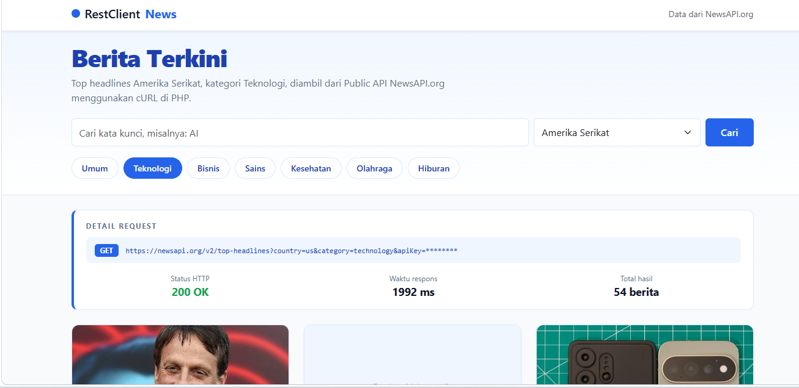
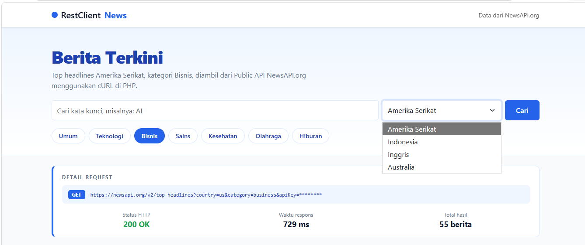

# News Rest Client (PHP + cURL + NewsAPI)

Aplikasi web sederhana yang menampilkan berita terbaru dari Public API
[NewsAPI.org](https://newsapi.org) menggunakan **cURL di PHP** dan **Bootstrap 5**.
Dibuat untuk Tugas 7 mata kuliah Pengujian Perangkat Lunak (Sistem Informasi, UNP Kediri),
mengacu pada tutorial
[Membuat Rest Client dengan cURL di PHP Bag 2](https://rudyekoprasetya.wordpress.com/2020/03/09/membuat-rest-client-dengan-curl-di-php-bag-2/).

## Tampilan Aplikasi

**Halaman utama** dengan panel Detail Request (endpoint, status HTTP 200 OK, waktu respons, dan total hasil):



**Daftar berita** dalam bentuk kartu, lengkap dengan sumber, penulis, waktu terbit, dan tombol Selengkapnya:


**Pilihan kategori dan negara** (contoh: kategori Bisnis, menu negara terbuka):



## Fitur
- Mengambil data dari endpoint `https://newsapi.org/v2/top-headlines`
- Pilihan kategori (umum, teknologi, bisnis, sains, kesehatan, olahraga, hiburan)
- Pilihan negara (Amerika Serikat, Indonesia, Inggris, Australia)
- Pencarian berita dengan kata kunci
- Panel **Detail Request** yang menampilkan endpoint, status HTTP, waktu respons, dan total hasil
- Penanganan error (API key salah, koneksi gagal, batas request tercapai)
- Tampilan putih dan biru dengan kartu berita yang responsif

## Struktur Folder
```
rest-client-newsapi
 |-- config
 |    |-- config.php           (fungsi cURL http_request_get)
 |    |-- apikey.example.php   (contoh file API key)
 |-- css
 |    |-- style.css
 |-- screenshots              (gambar tampilan aplikasi untuk README)
 |-- index.php                 (halaman utama)
 |-- .gitignore
 |-- README.md
```

## Cara Menjalankan
1. Daftar di [newsapi.org](https://newsapi.org) dan salin API key.
2. Letakkan folder ini di `htdocs` (XAMPP), lalu nyalakan **Apache**.
3. Salin `config/apikey.example.php` menjadi `config/apikey.php`, lalu isi API key Anda.
4. Buka `http://localhost/rest-client-newsapi/` di browser.

> `config/apikey.php` sudah masuk `.gitignore`, jadi API key tidak ikut terupload ke GitHub.

## Jika Muncul Error "SSL certificate problem"
Itu masalah sertifikat cURL di XAMPP. Solusi yang benar: unduh `cacert.pem` dari curl.se,
lalu isi `curl.cainfo` dan `openssl.cafile` di `php.ini`, kemudian restart Apache.
Solusi darurat untuk komputer lokal saja: ubah `SSL_VERIFY` menjadi `false` di `config/apikey.php`.
Jangan dipakai di server sungguhan.

## Catatan
Paket Developer NewsAPI gratis hanya untuk pengembangan, dan request dibatasi per hari.

## Penulis
Nabella Putri Kumalla, Sistem Informasi, UNP Kediri
